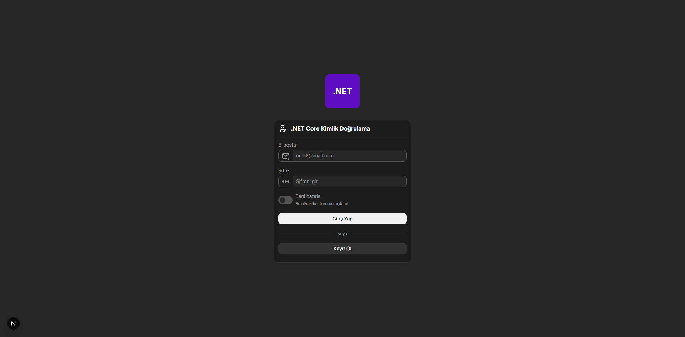

<div align="center">

# NLayerJwtExample

**Stateless JWT auth with RS256: a layered .NET 10 API and a Next.js 16 client.**




</div>

## Overview

Most JWT tutorials stop at one `Program.cs` that signs a token and checks it. This repo takes the same flow and puts it behind a normal layered structure: domain models and abstractions in `CoreLayer`, use cases in `BusinessLogicLayer`, storage in `DataAccessLayer`, and HTTP in `PresentationLayer`. Swapping the in-memory repository for EF Core would only touch one layer.

Access tokens are signed with a 3072-bit RSA key and verified with the public half of the pair, so a service that only validates tokens never needs the private key. Passwords go through PBKDF2-SHA256 with a random salt per password and a pepper that stays out of the database.

The client is a Next.js 16 app with login and registration. It keeps the access token in Redux and retries a request once after a `401`.

## Architecture

```text
┌──────────────────┐   Bearer JWT   ┌──────────────────────────────┐
│  Next.js client  │ ─────────────▶ │  PresentationLayer           │
│  Redux + Axios   │ ◀───────────── │  Minimal API · JWT bearer    │
└──────────────────┘                └──────────────┬───────────────┘
                                                   │
                                    ┌──────────────▼───────────────┐
                                    │  BusinessLogicLayer          │
                                    │  AccountManager · DTOs       │
                                    └──────────────┬───────────────┘
                                                   │
                                    ┌──────────────▼───────────────┐
                                    │  CoreLayer                   │
                                    │  Entities · abstractions     │
                                    │  JWT · password hashing      │
                                    └──────────────▲───────────────┘
                                                   │
                                    ┌──────────────┴───────────────┐
                                    │  DataAccessLayer             │
                                    │  In-memory repository        │
                                    └──────────────────────────────┘
```

| Layer | Responsibility | References |
|---|---|---|
| `CoreLayer` | Entities, abstractions, JWT helper, password hashing, options | — |
| `BusinessLogicLayer` | `AccountManager` use cases, DTOs, domain exceptions | `CoreLayer` |
| `DataAccessLayer` | Generic in-memory repository and `AccountRepository` | `CoreLayer` |
| `PresentationLayer` | Minimal API, DI, JWT bearer, CORS, error handling | `BusinessLogicLayer`, `DataAccessLayer` |
| `frontend` | Next.js UI, auth state, API client, theming | — |

Dependencies point toward `CoreLayer`, which has no idea ASP.NET Core exists. Only `PresentationLayer` is executable, and the solution uses the newer `.slnx` format.

## Stack

### Backend packages

| Package | Version | Project | Purpose |
|---|---|---|---|
| `Microsoft.AspNetCore.Authentication.JwtBearer` | 10.0.14 | `CoreLayer` | JWT bearer authentication and token validation |
| `Microsoft.AspNetCore.OpenApi` | 10.0.13 | `PresentationLayer` | OpenAPI document generation |
| `System.IdentityModel.Tokens.Jwt` | transitive | `CoreLayer` | Creating and writing JWTs |
| `Microsoft.IdentityModel.Tokens` | transitive | `CoreLayer` | Signing keys and validation parameters |

Two packages are referenced directly. The JWT types used in code (`JwtSecurityToken`, `RsaSecurityKey`, and similar) come in through `JwtBearer`. There is no database provider.

### Frontend packages

| Package | Version | Purpose |
|---|---|---|
| `next` | 16.4.5 | App Router and build tooling |
| `react` / `react-dom` | 19.3.0 | UI runtime |
| `@reduxjs/toolkit` | ^2.14.0 | Store and auth slice |
| `react-redux` | ^9.3.1 | React bindings for Redux |
| `axios` | ^1.21.0 | HTTP client with interceptors |
| `@astryxdesign/core` | ^0.7.11 | Component library and layout primitives |
| `@astryxdesign/theme-neutral` | ^0.7.11 | Neutral theme and fonts |
| `@astryxdesign/cli` | ^0.7.11 | Scaffolding and component CLI |
| `@stylexjs/stylex` | ^0.19.1 | Styling runtime required by Astryx |
| `@tabler/icons-react` | ^3.51.0 | Icons |

### Tooling

| Package | Version | Purpose |
|---|---|---|
| `typescript` | ^5 | Type checking |
| `tailwindcss` | ^4 | Utility classes |
| `@tailwindcss/turbopack` | ^4 | Tailwind loader for Turbopack |
| `eslint` | ^9 | Linting |
| `eslint-config-next` | 16.4.5 | Next.js and TypeScript rules |
| `@types/node`, `@types/react`, `@types/react-dom` | ^20 / ^19 | Type definitions |

The client uses pnpm 12.

## Getting started

You'll need the [.NET 10 SDK](https://dotnet.microsoft.com/), [OpenSSL](https://www.openssl.org/), Node.js 20 or newer, and pnpm 12.

**1. Clone the repository**

```bash
git clone <repository-url>
cd NLayerJwtExample
```

**2. Generate the RSA key pair**

```bash
mkdir -p PresentationLayer/Keys
openssl genpkey -algorithm RSA -pkeyopt rsa_keygen_bits:3072 -out PresentationLayer/Keys/private.pem
openssl pkey -pubout -in PresentationLayer/Keys/private.pem -out PresentationLayer/Keys/public.pem
```

On PowerShell, create the directory with `New-Item -ItemType Directory -Force PresentationLayer\Keys` and pass the same arguments to `openssl`.

**3. Start the API**

```bash
dotnet restore
dotnet run --project PresentationLayer
```

**4. Start the web client**

```bash
cd frontend
pnpm install
pnpm dev
```

The API listens on `http://localhost:5263` (the HTTPS profile uses `https://localhost:7187`). The client runs on `http://localhost:3000`.

## Configuration

JWT settings live in `PresentationLayer/appsettings.json`:

```json
{
  "TokenOptions": {
    "Issuer": "https://localhost:5263",
    "Audience": "https://localhost:5263",
    "AccessTokenExpiration": 15,
    "PrivateKeyPath": "Keys/private.pem",
    "PublicKeyPath": "Keys/public.pem"
  }
}
```

| Key | Meaning |
|---|---|
| `Issuer` | `iss` claim and expected token issuer |
| `Audience` | `aud` claim and expected recipient |
| `AccessTokenExpiration` | Token lifetime in minutes |
| `PrivateKeyPath` | RSA private key used for signing |
| `PublicKeyPath` | RSA public key used for validation |

Both paths are resolved from the content root, so `dotnet run --project PresentationLayer` works from the repo root. Missing keys or incomplete options stop the app at startup instead of failing on the first login.

Two things are not in `appsettings.json`: the CORS origin (`http://localhost:3000`, with credentials) sits in `Program.cs`, and the API URL is set in `frontend/src/lib/axios/index.ts`.

## How authentication works

**Registration.** The email is trimmed and checked against active accounts; a duplicate returns `409`. The password is hashed, an `Account` with the `User` role is created, and the response is `201` with a sanitized account object.

**Login.** The account is found by email, ignoring case. If it doesn't exist, the API still runs a dummy derivation with the same cost, so response time doesn't reveal which emails are registered. A wrong password and a deactivated account both get `401`. A successful login returns an RS256 token with a `jti` and the account id.

**Protected requests.** The client sends `Authorization: Bearer <token>`. Middleware checks the signature with the public key, then the issuer, audience, lifetime, and algorithm. `RSA-SHA256` is the only accepted algorithm, and clock skew is capped at 30 seconds. Claims aren't read until all of that passes.

Role claims come from operation claims, but nothing populates them yet, so tokens currently carry none.

## Password storage

A hash looks like `2$600000$1$<salt>$<hash>`: format version, iteration count, pepper version, salt, and hash. PBKDF2-SHA256 runs 600,000 iterations over the normalized password and a fresh 16-byte salt, then HMAC-SHA256 signs the result with a 32-byte pepper. Comparison is constant-time.

A few details that are easy to skip:

- Old v1 hashes that predate the pepper still verify, and `NeedsRehash` tells you when to upgrade one.
- The iteration count comes from the hash, so it's capped at 2,000,000 to keep a tampered record from burning CPU.
- Bad or malformed input still triggers a dummy derivation, which keeps timing close to a real check.
- Buffers for the password, salt, derived key, and pepper are zeroed after use.
- Passwords are limited to 1024 UTF-8 bytes and normalized to Unicode FormC.

## API reference

| Method | Endpoint | Access | Result |
|---|---|---|---|
| `POST` | `/accounts/register` | Anonymous | `201` with `AccountResponse` |
| `POST` | `/accounts/login` | Anonymous | `200` with access token |
| `GET` | `/accounts` | Bearer token | Active accounts |
| `GET` | `/accounts/{id:guid}` | Bearer token | One active account or `404` |
| `PUT` | `/accounts/{id:guid}/email` | Bearer token | `204`, or `409` if taken |
| `DELETE` | `/accounts/{id:guid}` | Bearer token | `204`, soft delete |
| `GET` | `/dev/generate-pepper` | Development only | Random 32-byte pepper |
| `GET` | `/openapi/v1.json` | Development only | OpenAPI document |

**Register and log in**

```http
POST /accounts/register
Content-Type: application/json

{ "email": "user@example.com", "password": "YourPassword" }
```

```http
POST /accounts/login
Content-Type: application/json

{ "email": "user@example.com", "password": "YourPassword" }
```

```json
{
  "token": "eyJhbGciOiJSUzI1NiIsInR5cCI6IkpXVCJ9...",
  "expiration": "2026-01-01T12:15:00Z"
}
```

**Call a protected endpoint**

```http
GET /accounts
Authorization: Bearer YOUR_ACCESS_TOKEN
```

**Change an email**

```http
PUT /accounts/{id}/email
Authorization: Bearer YOUR_ACCESS_TOKEN
Content-Type: application/json

{ "newEmail": "new@example.com" }
```

Accounts are serialized as:

```json
{
  "id": "3f1b5b1e-8a0c-4d6e-9b1a-2c3d4e5f6a7b",
  "email": "user@example.com",
  "role": "User",
  "createdDate": "2026-01-01T12:00:00Z",
  "updatedDate": null,
  "isDeleted": false
}
```

Domain errors come back as `ProblemDetails`: `409` for a duplicate email, `404` for a missing account, `401` for bad credentials, and `400` for bad arguments.

## Frontend

The client has one screen for login and registration (Turkish text) inside an Astryx `AppShell`, using the neutral theme in dark mode. Tabler supplies the icons, and Tailwind handles spacing and small layout tweaks.

State is a Redux Toolkit slice holding `accessToken` and a `status` of `idle`, `loading`, `authenticated`, or `unauthenticated`. The store is a singleton in the browser and created per request on the server, so one user's state can't leak into another's render. `useAuth` wraps the actions behind `login`, `register`, and `logout`.

An Axios instance points at the API, sends cookies (`withCredentials`), and adds the bearer header from the store. On a `401` it tries one refresh call, updates Redux, and replays the original request. Parallel failures wait on the same refresh promise instead of firing several.

| Script | Description |
|---|---|
| `pnpm dev` | Development server with Turbopack |
| `pnpm build` | Production build |
| `pnpm start` | Serve the production build |
| `pnpm lint` | ESLint |

## Project layout

```text
NLayerJwtExample/
├─ CoreLayer/
│  ├─ Models/                 Account, OperationClaim, base entity
│  ├─ DataAccess/Abstracts/   IRepository, IAccountRepository
│  └─ Utils/Security/
│     ├─ Hashing/             PasswordHasher
│     └─ Jwt/                 JwtHelper, TokenOptions, AccessToken
├─ BusinessLogicLayer/
│  ├─ Concretes/              AccountManager
│  ├─ Dtos/                   LoginDto, RegisterDto, AccountResponse
│  └─ Exceptions/             Domain exceptions
├─ DataAccessLayer/Concretes/ In-memory repository, AccountRepository
├─ PresentationLayer/
│  ├─ Handlers/               DomainExceptionHandler
│  ├─ Keys/                   RSA key pair (private key ignored by Git)
│  ├─ Program.cs
│  └─ appsettings.json
├─ frontend/
│  ├─ src/app/                Layout, page, global styles
│  ├─ src/features/auth/      Auth slice and hook
│  ├─ src/lib/                Axios client and Redux store
│  └─ src/astryx-themes.ts
├─ assets/ss.png
├─ NLayerJwtExample.slnx
└─ ReadMe.md
```

## Security notes

Before deploying this anywhere public, fix these:

- **Rotate the RSA key.** The private key was committed before it was added to `.gitignore`. Treat the current pair as compromised. Generate a new one, and if the repo is public, purge the old key from history.
- **The pepper is hardcoded** in `PasswordHasher`. Read it from a secret store or environment variable. The version field is there so you can rotate it without breaking existing hashes.
- **Serve the API over HTTPS.** Bearer tokens and passwords are plain text on the wire otherwise.
- **Shorten token lifetimes** and add refresh tokens before keeping users signed in for long periods.
- **Rate-limit `/accounts/login` and `/accounts/register`.** PBKDF2 makes each attempt expensive, but that alone won't stop a botnet.

Keys generated from now on are ignored by Git through the `*.pem` and `*.key` rules. If a deployment needs the public key, add it with `git add -f`.

## Known limitations

- No refresh endpoint. The Axios client calls `POST /account/refresh`, but the API doesn't define it.
- `/dashboard` doesn't exist. A successful login navigates there and lands on a 404.
- Accounts live in memory, so a restart wipes them. Duplicate emails are caught by a LINQ check, not a unique index.
- Registration pretends to send a confirmation email. It doesn't.
- No tests and no CI.

## License

There is no license file yet. Treat this as a learning project and add a license before you publish or reuse it.
